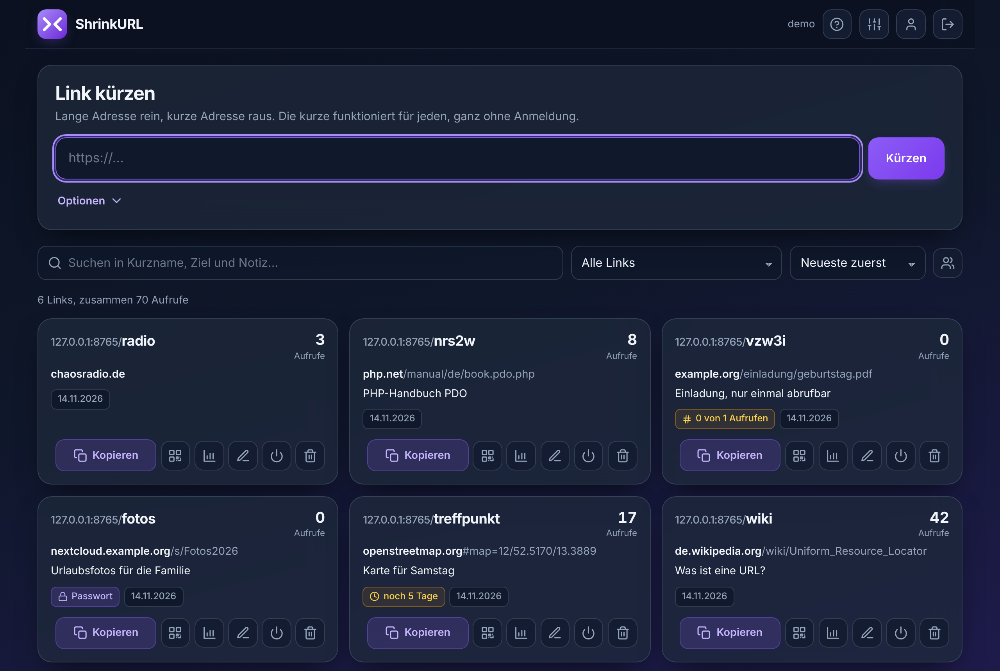

# ShrinkURL

A self-hosted link shortener in **plain PHP**, installed with a single file. No dependencies, no build step, no MySQL, no requests to third-party servers. Runs on simple shared web hosting.

Short links work for everyone without signing in. Only people with an account can create and manage them.

Plus **files and notes for pick-up**: encrypted in the browser, deleted from the server after pick-up or after a period.

Upload `shrinkurl-install.php`, open it in the browser, create the first account. That is the whole installation.

**Deutsche Fassung: [README.md](README.md)**



*Sample data, made up for the screenshot.*

## Privacy

This is what ShrinkURL is about first of all:

- When a short link is visited, **only a counter per link and day** is increased. Nothing else.
- No IP addresses, no cookies for visitors, no browser identifiers, no referrers, no fingerprinting.
- The destination does not learn which short link someone came through (`Referrer-Policy: no-referrer`).
- Font, icons and QR codes come from your own server or are created in the browser. Nothing is loaded from outside.
- A cookie exists only for signed-in users of the dashboard (the session), never for visitors of a short link.
- Files and notes are encrypted in the browser (AES-256-GCM), including file name and type. The key is in the link after the `#` and never reaches the server. The server only holds unreadable data.
- The one exception, so that nobody can guess passwords: after a **wrong** password (sign-in or protected link), a non-reversible checksum of the address and a failure counter are kept for at most one day. Simply visiting a link leaves nothing behind.

Your web server's log files are not part of ShrinkURL. Whether IP addresses end up there is a setting at your hosting provider.

## Features

- Shorten links with a random short code or a custom name (`short.example.org/holiday`)
- Expiry date, limited number of visits (including "only once") and password protection per link
- Links with a password or a limit show an intermediate page first, so a messenger's link preview does not use up a visit
- Preview: a `+` after the short link shows the destination without redirecting and without counting
- Tracking parameters (`utm_…`, `fbclid`, `gclid` and the like) can be removed when shortening
- QR code for every link, computed in the browser, downloadable as SVG or PNG
- Statistics per link: visits per day for 30 days, 90 days or a year
- **Send files:** one or several files at once, encrypted in the browser and uploaded in pieces (so they fit through tight upload limits). The recipient only needs the link and can pick up each file individually or all in a row. Period, number of pick-ups and password are configurable, after the last pick-up a file is deleted immediately.
- **Memorable links:** files and notes get a pick-up code of three words and a number, e.g. `short.example.org/f#wave-apple-table-87`. It can be read out loud and typed in at `short.example.org/f`.
- **Send a note:** the same for text, e.g. a password that should not stay in a chat forever
- Limits for files in the administration: largest file, total space, longest retention
- Search, filter, sort, edit, switch off, delete, export as CSV
- Multiple users. The administrator creates accounts, there is no open registration. Everyone sees only their own links.
- Two-factor sign-in (TOTP), recovery code, throttling against guessing
- Quick-shorten button for the bookmarks bar, installable as an app on phones with an entry in the share menu
- Light and dark mode with three colours (violet, blue, green), interface in German and English
- Expired links are deleted automatically after a configurable period
- Custom site name, links to legal notice and privacy policy

## Requirements

- PHP 7.4 or newer (8.x recommended) with the `pdo_sqlite` extension, which is enabled at almost every provider
- Apache with `mod_rewrite` and `.htaccess` (the default on shared hosting). Nginx needs its own rule, see below.
- **HTTPS.** Without HTTPS your password travels in plain text.
- Ideally a (sub)domain of its own so links stay short. A subfolder works too.

Everything is stored in one SQLite file in the folder `data/`, encrypted files live in `data/files/`. There is nothing to set up for that.

Files and notes need HTTPS in the browser (otherwise encryption is not available).

## Installation

1. Download `shrinkurl-install.php` from the [latest release](../../releases/latest) and copy it into the directory of your (sub)domain.
2. PHP must be allowed to write to that directory (it creates `index.php`, `.htaccess`, the folder `app/` and later `data/` there).
3. Open `shrinkurl-install.php` in the browser **right away** and click "Install now". The file unpacks the program, deletes itself and redirects. Create the first account there. That account is the administrator.
4. Check that `data/` cannot be reached from outside: `https://your-domain/data/config.php` must show "403" or "Forbidden".
5. Under *Account*, create a recovery code and turn on two-factor sign-in.

> Whoever opens a freshly uploaded, not yet set up ShrinkURL first becomes the administrator. So do step 3 right after uploading.

**Prefer doing it by hand?** The release also contains `shrinkurl-<version>.zip`. Unpack it and upload the contents of the folder `shrinkurl/`, that is `index.php` **and** the folder `app/`. ShrinkURL creates the `.htaccess` itself on first use and never overwrites an existing one.

### Updating

Upload the new `shrinkurl-install.php` and open it. Only the program files are replaced, the folder `data/` with accounts and links is left untouched.

### Backup

The whole state lives in the folder `data/`.

```bash
# create a backup (in the ShrinkURL directory)
cp -a data "data-backup-$(date +%F)"

# restore (adjust the date)
rm -rf data && cp -a data-backup-2026-11-14 data
```

### Clean-up by cron job (optional)

Without a cron job ShrinkURL cleans up once a day as soon as someone opens the dashboard. Once a day is enough. Either have `https://your-domain/?action=cron` called or run `index.php` as a script:

```bash
php /path/to/shrinkurl/index.php
```

### Nginx

```nginx
location ~ ^/(data|app)/ { deny all; }
location / { try_files $uri /index.php$is_args$args; }
```

## Security

- Passwords are stored only as hashes (`password_hash`), including the passwords of individual links and the recovery code.
- The database file has a random name that is kept in `data/config.php`, so it cannot be guessed even if the protection of `data/` should fail.
- Every dashboard action needs a sign-in and a security token (CSRF protection). Scripts only run with the page's nonce (Content Security Policy).
- A new password signs out all other devices.
- Short links only lead to `http` and `https` addresses and never to the installation itself.
- The administrator can display the links of all users. That is intentional: whoever runs the domain is responsible for where it redirects.

Found a vulnerability? Please do not open a public issue, use "Report a vulnerability" on the repository's *Security* tab.

## Files and notes in detail

- The link looks like `https://your-domain/f#word-word-word-12`. Browsers never send the part after the `#` to the server. From the pick-up code the browser computes the id of the shipment (sent to the server) and the key (kept in the browser).
- **How strong is the pick-up code?** Three words out of about 4000 plus a two-digit number give roughly 5 trillion possibilities. Guessing over the network is hopeless. Someone who has copied the encrypted files straight from the server (a breach at the hoster) can try codes offline, though. Every attempt is made deliberately expensive (PBKDF2, one million rounds), but by a rough estimate that still costs only years of GPU time, not millennia. For especially confidential content there is the option "Long link" with a random 256-bit key (`/f/<id>#<key>`).
- Several files under one link are counted and deleted individually, each after its last allowed pick-up.
- Whoever has the link can pick up, so only pass it to the intended person. An additional password protects in case the link ends up in the wrong hands.
- The server does not know the key. You can therefore only copy the link again later in the browser you uploaded from (it remembers the key locally).
- Deletion happens as soon as the last piece of the last allowed pick-up has been delivered, otherwise after the period. Expired items are removed at most every 10 minutes, triggered by normal requests. A cron job makes sure this also happens when nobody comes by at all.
- Defaults: 1 GB per file, 20 GB in total, 30 days. All configurable in the administration.
- iPhones have no share target for web apps, only Chrome on Android supports it.

## Development

```bash
php -S 127.0.0.1:8080 index.php     # test server, then open http://127.0.0.1:8080/
php tools/extract-strings.php       # checks that every German text has an English version
php tools/build-release.php         # builds dist/shrinkurl-install.php and the ZIP
```

## License

[GNU Affero General Public License v3.0](LICENSE). Font: [Inter](https://github.com/rsms/inter) (SIL Open Font License 1.1). Icons: [Lucide](https://lucide.dev) (ISC license). Word lists for pick-up codes: German from [dys2p/wordlists-de](https://github.com/dys2p/wordlists-de) (Unlicense, CC0 or BSD-3-Clause), English from the [Electronic Frontier Foundation](https://www.eff.org/deeplinks/2016/07/new-wordlists-random-passphrases) (CC BY 3.0 US), both filtered. Everything is embedded.

Structure, installer and parts of the code come from the sister project [LinkVault](https://github.com/burnersen/LinkVault).
