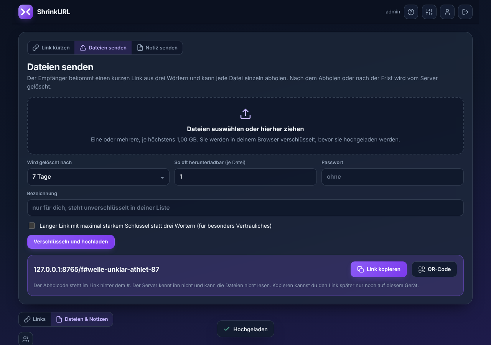
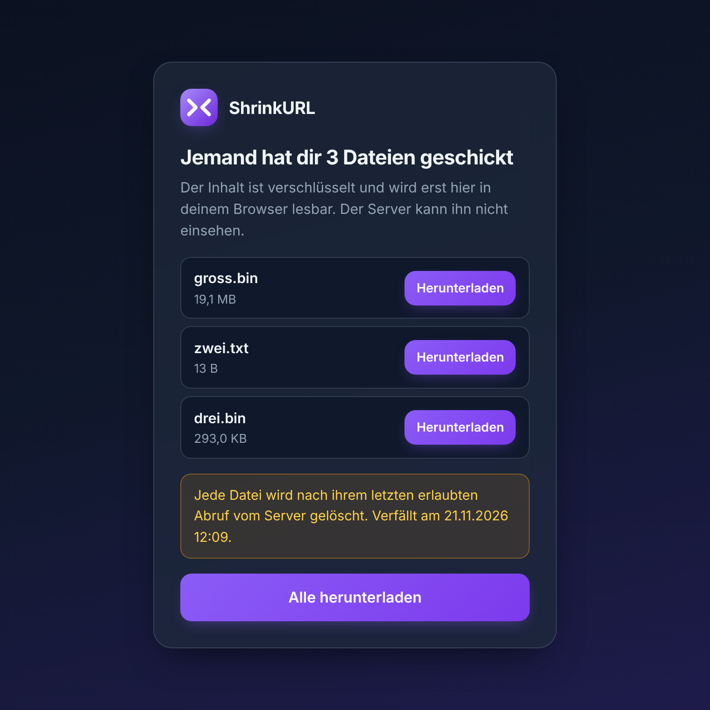
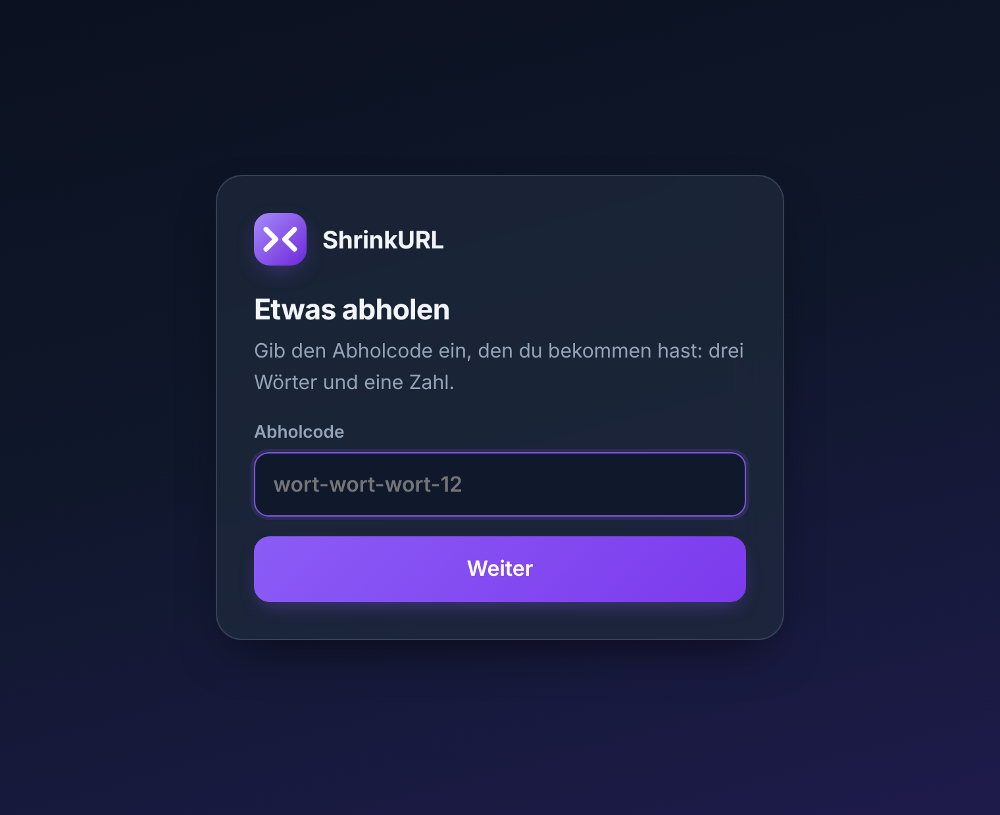

# ShrinkURL

Ein Link-Kürzer zum Selbsthosten in **reinem PHP**, installiert mit einer einzigen Datei. Keine Abhängigkeiten, kein Build-Schritt, kein MySQL, keine Abrufe bei fremden Servern. Läuft auf einfachem Webspace, zum Beispiel einem Netcup Webhosting.

Kurzlinks funktionieren für jeden, ganz ohne Anmeldung. Anlegen und verwalten kann sie nur, wer ein Konto hat.

Dazu **Dateien und Notizen zum Abholen**: im Browser verschlüsselt, nach dem Abholen oder nach einer Frist vom Server gelöscht.

`shrinkurl-install.php` hochladen, im Browser öffnen, erstes Konto anlegen. Das ist die ganze Installation.

**English version: [README.en.md](README.en.md)**

**[🌐 Webseite](https://tech.burnersen.de/tools/shrinkurl/)** · <sub>🇬🇧 In English: [tech.burnersen.de/en/tools/shrinkurl-en](https://tech.burnersen.de/en/tools/shrinkurl-en/)</sub>

[](#voraussetzungen)
[](#lizenz)
[](https://ko-fi.com/burnersen)

**[⬇️ Neuestes Release herunterladen](../../releases/latest)** · **[☕ Spendier mir einen Kaffee](https://ko-fi.com/burnersen)**


*Beispieldaten, erfunden für den Screenshot.*

> 💜 **Gefällt dir ShrinkURL?** Ein ⭐ auf GitHub ist die einfachste Art, mir das zu sagen, und es bringt mehr, als man denkt: Sterne sind der sichtbare Beweis, dass ein Projekt gute Arbeit leistet, und genau darüber finden andere kleine Projekte wie dieses überhaupt erst Leute. Oder [erzähl mir, wofür du es nutzt](https://github.com/burnersen/ShrinkURL/issues/new), ich lese jede Nachricht. Danke, dass du da bist!

## Datenschutz

Darum geht es bei ShrinkURL zuerst:

- Beim Aufruf eines Kurzlinks wird **nur ein Zähler pro Link und Tag** erhöht. Sonst nichts.
- Keine IP-Adressen, keine Cookies für Besucher, keine Browser-Kennungen, keine Herkunftsseiten, kein Fingerprinting.
- Die Zielseite erfährt nicht, über welchen Kurzlink jemand kam (`Referrer-Policy: no-referrer`).
- Schrift, Symbole und QR-Codes kommen vom eigenen Server oder entstehen im Browser. Es wird nichts von außen nachgeladen.
- Ein Cookie gibt es nur für angemeldete Benutzer der Verwaltung (die Sitzung), nie für Besucher eines Kurzlinks.
- Dateien und Notizen werden im Browser verschlüsselt (AES-256-GCM), auch Dateiname und Typ. Der Schlüssel steckt im Link hinter dem `#` und erreicht den Server nie. Auf dem Server liegt nur Unlesbares.
- Einzige Ausnahme, damit niemand Passwörter durchprobieren kann: Nach einer **falschen** Passworteingabe (Anmeldung oder geschützter Link) wird für höchstens einen Tag eine nicht zurückrechenbare Prüfsumme der Adresse samt Fehlerzähler abgelegt. Wer einen Link einfach nur aufruft, hinterlässt nichts.

Die Logdateien deines Webservers gehören nicht zu ShrinkURL. Ob dort IP-Adressen landen, stellst du bei deinem Hoster ein.

## Funktionen

- Links kürzen, mit zufälligem Kurzcode oder eigenem Wunschnamen (`kurz.example.org/urlaub`)
- Ablaufdatum, begrenzte Zahl an Aufrufen (auch „nur einmal“) und Passwortschutz pro Link
- Links mit Passwort oder Limit zeigen erst eine Zwischenseite. So verbraucht die Link-Vorschau eines Messengers keinen Aufruf.
- Vorschau: ein `+` hinter dem Kurzlink zeigt das Ziel, ohne weiterzuleiten und ohne zu zählen
- Tracking-Anhängsel (`utm_…`, `fbclid`, `gclid` und ähnliche) werden beim Kürzen auf Wunsch entfernt
- QR-Code zu jedem Link, im Browser berechnet, als SVG oder PNG zum Herunterladen
- Statistik pro Link: Aufrufe pro Tag für 30 Tage, 90 Tage oder ein Jahr
- **Dateien senden:** eine oder mehrere Dateien auf einmal, im Browser verschlüsselt und in Stücken hochgeladen (passt so auch durch enge Upload-Grenzen des Hosters). Der Empfänger braucht nur den Link und kann jede Datei einzeln oder alle nacheinander abholen. Frist, Zahl der Abrufe und Passwort sind einstellbar, nach dem letzten Abruf wird sofort gelöscht.
- **Merkbare Links:** Dateien und Notizen bekommen einen Abholcode aus drei Wörtern und einer Zahl, zum Beispiel `kurz.example.org/f#welle-apfel-tisch-87`. Den kann man auch durchsagen und unter `kurz.example.org/f` eintippen.
- **Notiz senden:** dasselbe für Text, zum Beispiel ein Passwort, das nicht dauerhaft in einem Chat stehen soll
- Grenzen für Dateien in der Verwaltung: größte Datei, Platz insgesamt, längste Aufbewahrung
- Suchen, filtern, sortieren, bearbeiten, abschalten, löschen, Export als CSV
- Mehrere Benutzer. Der Administrator legt Konten an, es gibt keine offene Registrierung. Jeder sieht nur seine eigenen Links.
- Zwei-Faktor-Anmeldung (TOTP), Wiederherstellungscode, Bremse gegen Durchprobieren
- Schnell-Kürzen-Knopf für die Lesezeichen-Leiste, am Handy als App installierbar mit Eintrag im Teilen-Menü
- Heller und dunkler Modus mit drei Farben (Violett, Blau, Grün), Oberfläche auf Deutsch und Englisch
- Abgelaufene Links werden nach einer einstellbaren Frist automatisch gelöscht
- Eigener Name der Seite, Links zu Impressum und Datenschutzerklärung

| QR-Code | Statistik | Geschützter Link |
|---|---|---|
|  |  |  |

| Dateien senden | Dateien abholen | Abholcode eintippen |
|---|---|---|
|  |  |  |

## Voraussetzungen

- PHP 7.4 oder neuer (empfohlen 8.x) mit der Erweiterung `pdo_sqlite`. Die ist bei fast jedem Hoster von Haus aus an.
- Apache mit `mod_rewrite` und `.htaccess` (Standard bei Webhosting). Nginx braucht eine eigene Regel, siehe unten.
- **HTTPS.** Ohne HTTPS geht dein Passwort im Klartext durchs Netz.
- Am besten eine eigene (Sub-)Domain, damit die Links kurz bleiben. Ein Unterordner geht auch.

Gespeichert wird in einer SQLite-Datei im Ordner `data/`, verschlüsselte Dateien liegen in `data/files/`. Dafür musst du nichts einrichten.

Für Dateien und Notizen braucht der Browser HTTPS (sonst steht die Verschlüsselung nicht zur Verfügung).

## Installation

1. Aus dem [neuesten Release](../../releases/latest) die Datei `shrinkurl-install.php` herunterladen und in das Verzeichnis deiner (Sub-)Domain kopieren.
2. PHP muss in dieses Verzeichnis schreiben dürfen (es legt dort `index.php`, `.htaccess`, den Ordner `app/` und später `data/` an).
3. `shrinkurl-install.php` **sofort** im Browser aufrufen und auf „Jetzt installieren“ klicken. Die Datei packt das Programm aus, löscht sich selbst und leitet weiter. Dort das erste Konto anlegen. Dieses Konto ist der Administrator.
4. Prüfen, dass `data/` von außen nicht erreichbar ist: `https://deine-domain/data/config.php` muss „403“ oder „Forbidden“ zeigen.
5. Unter *Konto* einen Wiederherstellungscode anlegen und die Zwei-Faktor-Anmeldung einschalten.

> Wer ein frisch hochgeladenes, noch nicht eingerichtetes ShrinkURL als Erster aufruft, wird Administrator. Schritt 3 also direkt nach dem Hochladen erledigen.

**Lieber von Hand?** Im Release liegt auch `shrinkurl-<Version>.zip`. Entpacken und den Inhalt des Ordners `shrinkurl/` hochladen, also `index.php` **und** den Ordner `app/`. Die `.htaccess` legt ShrinkURL beim ersten Aufruf selbst an, eine vorhandene wird nie überschrieben.

### Update

Neue `shrinkurl-install.php` hochladen und aufrufen. Ersetzt werden nur die Programmdateien, der Ordner `data/` mit Konten und Links bleibt unangetastet.

### Sicherung

Der ganze Zustand steckt im Ordner `data/`. Wer den sichert, hat alles.

```bash
# Sicherung anlegen (im Verzeichnis von ShrinkURL)
cp -a data "data-sicherung-$(date +%F)"

# Zurückholen (Datum anpassen)
rm -rf data && cp -a data-sicherung-2026-11-14 data
```

### Aufräumen per Cronjob (freiwillig)

Ohne Cronjob räumt ShrinkURL einmal am Tag auf, sobald jemand die Verwaltung öffnet. Mit Cronjob passiert das auch, wenn niemand da ist. Einmal täglich reicht. Entweder die Adresse `https://deine-domain/?action=cron` aufrufen lassen oder die `index.php` als Skript starten:

```bash
php /pfad/zu/shrinkurl/index.php
```

### Nginx

Nginx kennt keine `.htaccess`. Dort braucht es diese Regeln:

```nginx
location ~ ^/(data|app)/ { deny all; }
location / { try_files $uri /index.php$is_args$args; }
```

## Aufbau

```
index.php      Einstieg und Einstellungen
app/lib/       Funktionen (Datenbank, Weiterleitung, Konten, Anmeldung, Links, Aussehen)
app/routes/    Schrift, Icon, Manifest, Aufräumen und alle JSON-Aktionen
app/views/     Anmeldeseite und Hauptseite (HTML, CSS, JavaScript)
tools/         Release bauen, Übersetzungen prüfen (nur für Entwickler)
data/          entsteht beim ersten Start, hier liegt alles Geheime
```

Ein Kurzlink-Aufruf lädt nur das Nötigste: eine Datenbankabfrage, Zähler erhöhen, weiterleiten. Die Dateien in `app/` tun nichts, wenn man sie direkt aufruft, unter Apache sperrt eine `.htaccess` den Ordner zusätzlich.

## Sicherheit

- Passwörter liegen nur als Prüfsumme vor (`password_hash`), auch die Passwörter einzelner Links und der Wiederherstellungscode.
- Die Datenbank-Datei hat einen zufälligen Namen, der in `data/config.php` steht. Selbst wenn die Sperre von `data/` einmal nicht greift, lässt sie sich nicht erraten.
- Alle Aktionen der Verwaltung brauchen eine Anmeldung und ein Sicherheits-Token (CSRF-Schutz). Skripte laufen nur mit dem Einmal-Kennzeichen der Seite (Content Security Policy).
- Ein neues Passwort meldet alle anderen Geräte ab.
- Kurzlinks führen nur auf `http`- und `https`-Adressen und nie auf die eigene Installation.
- Der Administrator kann sich die Links aller Benutzer anzeigen lassen. Das ist Absicht: Wer die Domain betreibt, ist dafür verantwortlich, wohin sie weiterleitet.

Eine Sicherheitslücke gefunden? Bitte nicht als öffentliches Issue, sondern über „Report a vulnerability“ im Reiter *Security* des Repositorys.

## Dateien und Notizen im Detail

- Der Link sieht so aus: `https://deine-domain/f#wort-wort-wort-12`. Browser schicken den Teil hinter dem `#` nie an den Server. Aus dem Abholcode berechnet der Browser die Kennung der Sendung (die bekommt der Server) und den Schlüssel (der bleibt im Browser).
- **Wie sicher ist der Abholcode?** Drei Wörter aus rund 4000 und eine zweistellige Zahl ergeben etwa 5 Billionen Möglichkeiten. Durchprobieren über das Netz ist damit aussichtslos. Wer allerdings die verschlüsselten Dateien direkt vom Server kopiert hat (Einbruch beim Hoster), kann Codes ohne den Server durchprobieren. Jeder Versuch ist absichtlich teuer gemacht (PBKDF2, eine Million Runden), das kostet nach grober Schätzung trotzdem nur Jahre an Grafikkarten-Rechenzeit, nicht Jahrtausende. Für besonders Vertrauliches gibt es deshalb beim Senden die Option „Langer Link“ mit einem zufälligen 256-Bit-Schlüssel (`/f/<Kennung>#<Schlüssel>`).
- Mehrere Dateien unter einem Link werden einzeln gezählt und einzeln gelöscht, jede nach ihrem letzten erlaubten Abruf.
- Wer den Link hat, kann abholen. Gib ihn also nur an die Person weiter, für die er gedacht ist. Ein zusätzliches Passwort schützt, falls der Link in falsche Hände gerät.
- Der Server kennt den Schlüssel nicht. Den Link kannst du deshalb später nur in dem Browser noch einmal kopieren, von dem du hochgeladen hast (er merkt sich den Schlüssel lokal).
- Gelöscht wird sofort, sobald das letzte Stück des letzten erlaubten Abrufs ausgeliefert ist, sonst nach der Frist. Abgelaufenes räumt ShrinkURL höchstens alle 10 Minuten weg, angestoßen durch normale Aufrufe. Ein Cronjob sorgt dafür, dass das auch passiert, wenn gar niemand vorbeischaut.
- Vorgaben: höchstens 1 GB pro Datei, 20 GB insgesamt, 30 Tage. Alles in der Verwaltung änderbar. Sehr große Dateien brauchen beim Abholen einen aktuellen Browser, am Handy kann der Arbeitsspeicher die Grenze sein.
- Am iPhone gibt es kein Teilen-Ziel für Web-Apps, das unterstützt nur Chrome unter Android.

## Entwickeln

```bash
php -S 127.0.0.1:8080 index.php     # Testserver, dann http://127.0.0.1:8080/ öffnen
php tools/extract-strings.php       # prüft, ob jeder deutsche Text eine englische Fassung hat
php tools/build-release.php         # baut dist/shrinkurl-install.php und das ZIP
```

## ☕ Unterstützen

ShrinkURL ist kostenlos und entsteht in meiner Freizeit, auf meiner eigenen Hardware und Stromrechnung. Wenn es dir Zeit gespart hat und du Danke sagen möchtest, kannst du [ein kleines Trinkgeld bei Ko-fi dalassen](https://ko-fi.com/burnersen), das hält Motivation und Kaffee am Laufen. ☕ Völlig freiwillig, und in jedem Fall: danke fürs Benutzen!

## ⚠️ Haftungsausschluss

ShrinkURL ist kostenlose Hobby-Software und wird **so, wie es ist, ohne jede Gewähr** bereitgestellt. Es ist mit Sorgfalt gebaut und getestet, die Nutzung erfolgt aber **auf eigene Gefahr**. Sichere den Ordner `data/` regelmäßig selbst. Wer ShrinkURL auf einem eigenen Server betreibt, ist für diesen Server und für die Links und Dateien, die darüber geteilt werden, selbst verantwortlich.

Wo diese Anleitung beschreibt, was ShrinkURL tut, prüft oder nie tut, steht dort, wie es gedacht und gebaut ist, keine Zusage und keine Garantie: Software kann Fehler haben, und Systeme, Dienste und andere Programme verhalten sich nicht immer wie erwartet. Soweit gesetzlich zulässig, haftet der Autor nicht für Schäden oder Datenverlust durch die Nutzung dieser Software. Siehe Abschnitte 15 und 16 der [Lizenz](LICENSE).

## Lizenz

[GNU Affero General Public License v3.0](LICENSE). Schrift: [Inter](https://github.com/rsms/inter) (SIL Open Font License 1.1). Symbole: [Lucide](https://lucide.dev) (ISC-Lizenz). Wortlisten für die Abholcodes: deutsch aus [dys2p/wordlists-de](https://github.com/dys2p/wordlists-de) (Unlicense, CC0 oder BSD-3-Clause), englisch von der [Electronic Frontier Foundation](https://www.eff.org/deeplinks/2016/07/new-wordlists-random-passphrases) (CC BY 3.0 US), jeweils gefiltert. Alles ist eingebettet.

Aufbau, Installer und Teile des Codes stammen aus dem Schwesterprojekt [LinkVault](https://github.com/burnersen/LinkVault).
