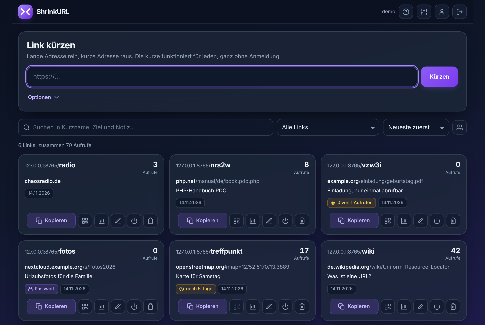
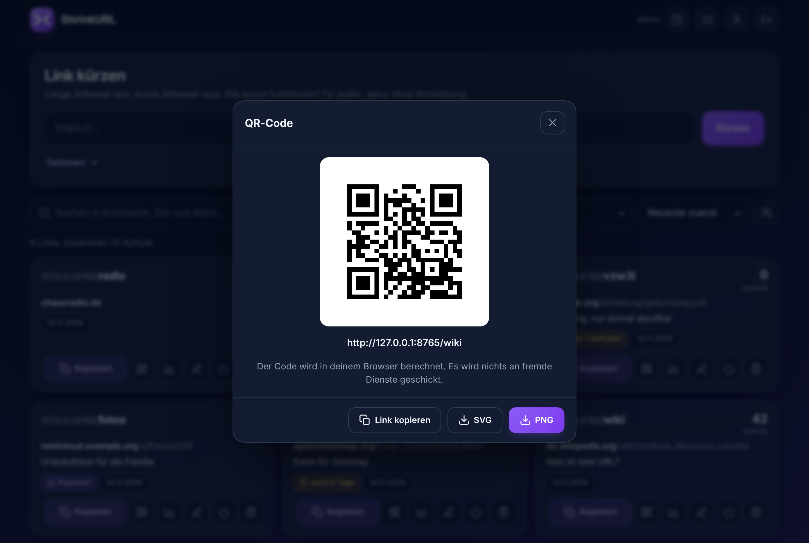
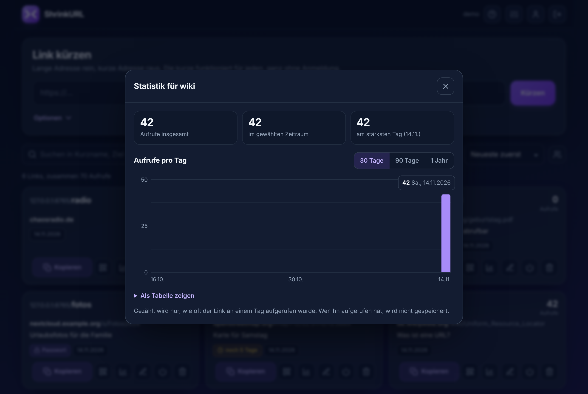
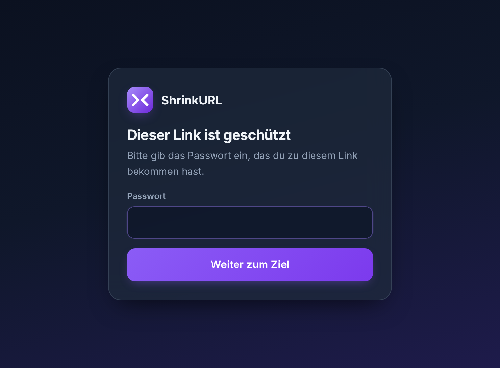

# ShrinkURL

Ein Link-Kürzer zum Selbsthosten in **reinem PHP**, installiert mit einer einzigen Datei. Keine Abhängigkeiten, kein Build-Schritt, kein MySQL, keine Abrufe bei fremden Servern. Läuft auf einfachem Webspace, zum Beispiel einem Netcup Webhosting.

Kurzlinks funktionieren für jeden, ganz ohne Anmeldung. Anlegen und verwalten kann sie nur, wer ein Konto hat.

`shrinkurl-install.php` hochladen, im Browser öffnen, erstes Konto anlegen. Das ist die ganze Installation.

**English version: [README.en.md](README.en.md)**



*Beispieldaten, erfunden für den Screenshot.*

## Datenschutz

Darum geht es bei ShrinkURL zuerst:

- Beim Aufruf eines Kurzlinks wird **nur ein Zähler pro Link und Tag** erhöht. Sonst nichts.
- Keine IP-Adressen, keine Cookies für Besucher, keine Browser-Kennungen, keine Herkunftsseiten, kein Fingerprinting.
- Die Zielseite erfährt nicht, über welchen Kurzlink jemand kam (`Referrer-Policy: no-referrer`).
- Schrift, Symbole und QR-Codes kommen vom eigenen Server oder entstehen im Browser. Es wird nichts von außen nachgeladen.
- Ein Cookie gibt es nur für angemeldete Benutzer der Verwaltung (die Sitzung), nie für Besucher eines Kurzlinks.
- Einzige Ausnahme, damit niemand Passwörter durchprobieren kann: Nach einer **falschen** Passworteingabe (Anmeldung oder geschützter Link) wird für höchstens einen Tag eine nicht zurückrechenbare Prüfsumme der Adresse samt Fehlerzähler abgelegt. Wer einen Link einfach nur aufruft, hinterlässt nichts.

Die Logdateien deines Webservers gehören nicht zu ShrinkURL. Ob dort IP-Adressen landen, stellst du bei deinem Hoster ein.

## Funktionen

- Links kürzen, mit zufälligem Kurzcode oder eigenem Wunschnamen (`kurz.example.org/urlaub`)
- Ablaufdatum, begrenzte Zahl an Aufrufen (auch „nur einmal“) und Passwortschutz pro Link
- Links mit Passwort oder Limit zeigen erst eine Zwischenseite. So verbraucht die Link-Vorschau eines Messengers keinen Aufruf.
- Vorschau: ein `+` hinter dem Kurzlink zeigt das Ziel, ohne weiterzuleiten und ohne zu zählen
- Tracking-Anhängsel (`utm_…`, `fbclid`, `gclid` und ähnliche) werden beim Kürzen auf Wunsch entfernt
- QR-Code zu jedem Link, im Browser berechnet, als SVG oder PNG zum Herunterladen
- Statistik pro Link: Aufrufe pro Tag für 30 Tage, 90 Tage oder ein Jahr
- Suchen, filtern, sortieren, bearbeiten, abschalten, löschen, Export als CSV
- Mehrere Benutzer. Der Administrator legt Konten an, es gibt keine offene Registrierung. Jeder sieht nur seine eigenen Links.
- Zwei-Faktor-Anmeldung (TOTP), Wiederherstellungscode, Bremse gegen Durchprobieren
- Schnell-Kürzen-Knopf für die Lesezeichen-Leiste, am Handy als App installierbar mit Eintrag im Teilen-Menü
- Heller und dunkler Modus mit drei Farben (Violett, Blau, Grün), Oberfläche auf Deutsch und Englisch
- Abgelaufene Links werden nach einer einstellbaren Frist automatisch gelöscht
- Eigener Name der Seite, Links zu Impressum und Datenschutzerklärung

| QR-Code | Statistik | Geschützter Link |
|---|---|---|
|  |  |  |

## Voraussetzungen

- PHP 7.4 oder neuer (empfohlen 8.x) mit der Erweiterung `pdo_sqlite`. Die ist bei fast jedem Hoster von Haus aus an.
- Apache mit `mod_rewrite` und `.htaccess` (Standard bei Webhosting). Nginx braucht eine eigene Regel, siehe unten.
- **HTTPS.** Ohne HTTPS geht dein Passwort im Klartext durchs Netz.
- Am besten eine eigene (Sub-)Domain, damit die Links kurz bleiben. Ein Unterordner geht auch.

Gespeichert wird in einer SQLite-Datei im Ordner `data/`. Dafür musst du nichts einrichten.

## Installation

1. Aus dem [neuesten Release](../../releases/latest) die Datei `shrinkurl-install.php` herunterladen und in das Verzeichnis deiner (Sub-)Domain kopieren.
2. PHP muss in dieses Verzeichnis schreiben dürfen (es legt dort `index.php`, `.htaccess`, den Ordner `app/` und später `data/` an).
3. `shrinkurl-install.php` **sofort** im Browser aufrufen und auf „Jetzt installieren“ klicken. Die Datei packt das Programm aus, löscht sich selbst und leitet weiter. Dort das erste Konto anlegen. Dieses Konto ist der Administrator.
4. Prüfen, dass `data/` von außen nicht erreichbar ist: `https://deine-domain/data/config.php` muss „403“ oder „Forbidden“ zeigen.
5. Unter *Konto* einen Wiederherstellungscode anlegen und die Zwei-Faktor-Anmeldung einschalten.

> Wer ein frisch hochgeladenes, noch nicht eingerichtetes ShrinkURL als Erster aufruft, wird Administrator. Schritt 3 also direkt nach dem Hochladen erledigen.

**Lieber von Hand?** Im Release liegt auch `shrinkurl-<Version>.zip`. Entpacken und den Inhalt des Ordners `shrinkurl/` hochladen, also `index.php` **und** den Ordner `app/`. Die `.htaccess` legt ShrinkURL beim ersten Aufruf selbst an, eine vorhandene wird nie überschrieben.

### Update

Neue `shrinkurl-install.php` hochladen und aufrufen. Ersetzt werden nur die Programmdateien, der Ordner `data/` mit Konten und Links bleibt unangetastet.

### Sicherung

Der ganze Zustand steckt im Ordner `data/`. Wer den sichert, hat alles.

```bash
# Sicherung anlegen (im Verzeichnis von ShrinkURL)
cp -a data "data-sicherung-$(date +%F)"

# Zurückholen (Datum anpassen)
rm -rf data && cp -a data-sicherung-2026-11-14 data
```

### Aufräumen per Cronjob (freiwillig)

Ohne Cronjob räumt ShrinkURL einmal am Tag auf, sobald jemand die Verwaltung öffnet. Mit Cronjob passiert das auch, wenn niemand da ist. Einmal täglich reicht. Entweder die Adresse `https://deine-domain/?action=cron` aufrufen lassen oder die `index.php` als Skript starten:

```bash
php /pfad/zu/shrinkurl/index.php
```

### Nginx

Nginx kennt keine `.htaccess`. Dort braucht es diese Regeln:

```nginx
location ~ ^/(data|app)/ { deny all; }
location / { try_files $uri /index.php$is_args$args; }
```

## Aufbau

```
index.php      Einstieg und Einstellungen
app/lib/       Funktionen (Datenbank, Weiterleitung, Konten, Anmeldung, Links, Aussehen)
app/routes/    Schrift, Icon, Manifest, Aufräumen und alle JSON-Aktionen
app/views/     Anmeldeseite und Hauptseite (HTML, CSS, JavaScript)
tools/         Release bauen, Übersetzungen prüfen (nur für Entwickler)
data/          entsteht beim ersten Start, hier liegt alles Geheime
```

Ein Kurzlink-Aufruf lädt nur das Nötigste: eine Datenbankabfrage, Zähler erhöhen, weiterleiten. Die Dateien in `app/` tun nichts, wenn man sie direkt aufruft, unter Apache sperrt eine `.htaccess` den Ordner zusätzlich.

## Sicherheit

- Passwörter liegen nur als Prüfsumme vor (`password_hash`), auch die Passwörter einzelner Links und der Wiederherstellungscode.
- Die Datenbank-Datei hat einen zufälligen Namen, der in `data/config.php` steht. Selbst wenn die Sperre von `data/` einmal nicht greift, lässt sie sich nicht erraten.
- Alle Aktionen der Verwaltung brauchen eine Anmeldung und ein Sicherheits-Token (CSRF-Schutz). Skripte laufen nur mit dem Einmal-Kennzeichen der Seite (Content Security Policy).
- Ein neues Passwort meldet alle anderen Geräte ab.
- Kurzlinks führen nur auf `http`- und `https`-Adressen und nie auf die eigene Installation.
- Der Administrator kann sich die Links aller Benutzer anzeigen lassen. Das ist Absicht: Wer die Domain betreibt, ist dafür verantwortlich, wohin sie weiterleitet.

Eine Sicherheitslücke gefunden? Bitte nicht als öffentliches Issue, sondern über „Report a vulnerability“ im Reiter *Security* des Repositorys.

## Geplant

- Dateien verschicken, die nach dem Herunterladen oder nach einer Frist gelöscht werden, im Browser verschlüsselt
- Selbstzerstörende Textnotizen

## Entwickeln

```bash
php -S 127.0.0.1:8080 index.php     # Testserver, dann http://127.0.0.1:8080/ öffnen
php tools/extract-strings.php       # prüft, ob jeder deutsche Text eine englische Fassung hat
php tools/build-release.php         # baut dist/shrinkurl-install.php und das ZIP
```

## Lizenz

[GNU Affero General Public License v3.0](LICENSE). Schrift: [Inter](https://github.com/rsms/inter) (SIL Open Font License 1.1). Symbole: [Lucide](https://lucide.dev) (ISC-Lizenz). Beides ist eingebettet.

Aufbau, Installer und Teile des Codes stammen aus dem Schwesterprojekt [LinkVault](https://github.com/burnersen/LinkVault).
